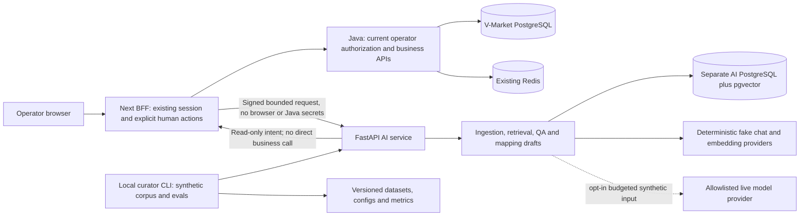

# P02 — Architecture design

Status: design and validated schemas only, **not an implemented AI service**. Date: 2026-10-31 Asia/Bangkok. Inputs: [P00 source audit](00-repo-audit.md), [P01 requirements](fde/requirements.md), Project2 SHA `32d82862526754b46efb774327ccc4774a4decf7`. P02 baseline AI SHA: `7372005d49899fdc947b8b5de3fe9d5bfdb37ba5`.

P03 implementation note: the health/readiness service, provider interfaces/fakes, guarded internal live adapter and AI storage foundation now exist; see [P03 evidence](evidence/P03.md). This P02 document remains the target design for later features. Signed context, business tools, document/RAG/mapping routes and integration are not enabled by the P03 skeleton.

## Components and ownership



| Component | Responsibility | Boundary / implementation phase |
| --- | --- | --- |
| FastAPI/Pydantic | Validate contract, enforce transport context, request budget and redacted errors | P03 foundation; later feature routes must not be advertised ready before implemented |
| ChatModel / EmbeddingProvider | Deterministic fake defaults; explicit allowlisted live config | P03; fake embeddings prove plumbing, not semantic quality |
| Ingestion | Raw document hash/provenance, robust supported parser, page/section, quality, immutable version and chunks | P04/P05; reject unsupported/scanned content rather than pretend OCR |
| Retrieval | Authorized lexical, pgvector dense, RRF hybrid; configurable genuine rerank stage only when implemented | P05/P06; same authorized corpus and model version per comparison |
| QA / mapping | Typed cited answers/abstention and three-field drafts | P07/P08; no authoritative business writes |
| Explicit controller | One tool intent per step, bounded continuation, validated result | P09; no multi-agent delegation or framework required |
| AI persistence | Documents/ACLs/chunks/indexes, drafts, traces, evals; optional later durable runs | P03–P11, separate DB credentials/migrations |
| BFF gateway | Current session and permission checks, signed context, hardcoded GET executor, data minimization | P09 additive feature-OFF routes; existing proxy is not this gateway |
| Existing Java | Source of business truth, live account checks, import lifecycle, protected human approval | Existing contracts remain unchanged |
| Evaluation / tracing | Offline command runner, fixed splits and raw predictions; correlation and bounded metadata | P03/P13/P15, no prompt/token content logged by default |

Local raw-document storage starts in the isolated AI volume with opaque IDs and no user-controlled path. Object storage is deferred; it must not introduce arbitrary URL fetch or a public bucket. Retrieval/query workers operate only on AI-owned storage. Python has no Java DB driver configuration or business endpoint credential.

## Modes and network

**Standalone demo:** FastAPI binds loopback `127.0.0.1:8090`, fake providers, fixture-only read tools, fixed synthetic demo document scope and no Java connectivity. Authentication bypass is restricted to explicit standalone mode and loopback; it is not an integrated deployment option. Container standalone port publishes only to host loopback. It demonstrates no real user/tenant isolation.

**Integrated local:** `AI_COPILOT_ENABLED=false` by default on BFF. The browser calls proposed `/api/ops/ai/ask`, `/mapping/suggest`, `/agent` and `/documents/...` through BFF only. These are NEW planned routes, not existing APIs. BFF authenticates OPERATOR, strips caller-provided AI identity headers, derives scope from server configuration and signs every Python request. Python has only BFF's AI-specific public verification key; no Java trust secret, cookie or CSRF token. A transport signature does not grant permission to call Java: BFF and Java reauthorize each tool. See [gateway protocol](contracts/gateway-protocol.md).

Use AI PostgreSQL host port `5434`, internal 5432, database `vmarket_ai`, distinct AI volume and credentials; AI API host port 8090. These do not reuse Project2's 5433/6380/8080. There is no Redis requirement for initial AI mode. Integrated service transport requires TLS with verified peers or an explicitly documented isolated same-host private Docker network; plain private-network HTTP does not provide confidentiality and is a local-only limitation. Never expose the Python service or AI DB publicly or describe a local Docker network as a security certification.

## End-to-end request lifecycle

```mermaid
sequenceDiagram
    participant U as Operator
    participant B as BFF gateway
    participant J as Java
    participant A as Python
    U->>B: Same-origin AI request with existing session
    B->>J: GET auth/session; check current authenticated ROLE_OPERATOR
    J-->>B: Session info; csrfToken stays inside BFF
    B->>A: Signed request and bounded input, scoped actor reference
    A-->>B: One typed tool intent or final draft
    B->>B: Validate exact request/run/step/call and allowlist
    B->>J: Recheck current session; execute only a fixed GET
    J-->>B: Authorized current result
    B->>B: Validate and select safe response fields
    B->>A: New signed step with matched sanitized result
    A-->>B: Draft answer, abstention or human handoff
    B->>J: Recheck session before returning protected answer
    B-->>U: Suggested output; business state unchanged
```

Default limits: 30-second request deadline including input/auth/model/tools, at most 4 model step calls, 3 business tool executions, one outstanding intent, no parallel model-selected tools; 8-second model call deadline and at most 5 seconds per Java subcall, always clipped by remaining outer time. The final model step cannot request another tool. A slow backend/cold start may yield an honest timeout and manual path. These are design limits to implement/test, not measured SLAs. Existing manual ops proxy keeps its separate 10-second upload/12-second upstream budgets.

BFF rate policy proposal: 10 AI requests/minute and one active AI agent request per verified session; provider/global token/concurrency budgets additionally bound anonymous resource abuse. Use a shared store when more than one BFF instance exists; process-local counters are only a single-instance demo control. A budget rejection never triggers a different paid model automatically.

## Contracts and feature availability

[OpenAPI](contracts/openapi.yaml) describes health/readiness, ask, mapping, agent step, AI document ingest/read. [Gateway JSON Schema](contracts/bff-tool-gateway.schema.json) fixes intent/context/result envelopes. `/ai/evals` is deliberately not exposed; evaluation is local CLI over versioned safe configuration, not an operator-triggered arbitrary job or URL. No endpoint in this design executes a business mutation. AI document ingest writes only AI storage under separate document-author capability.

CSV mapping uses raw `text/csv`, declares encoding/vendor in signed metadata and retains original SHA-256. JSON cap is 65,536 bytes; CSV/document raw body cap 5,000,000 bytes with dedicated bounded intake; CSV record cap 1,000. Document ingestion gets a separate planned BFF handler, not a change to existing Java proxy limits. Parser-specific uncompressed DOCX/extracted text/page caps are in [data model](data-model.md). Schema length hints do not replace streaming-byte/row caps, semantic checks or authorization.

Retrieval access is derived from signed server policy scope, applied before lexical/dense/rerank/context. User-supplied collection/vendor filters can only narrow it. Citation IDs must resolve to the selected current document version, and opening a citation rechecks authorization. Render escaped text; do not execute generated HTML, SQL, mapping code or links.

## Failure, operations and evidence

Fake is default, live requests require explicit configuration, known price/budget and per-request accounting. Unknown prices disable live requests. Reserve worst-case budget before a call; record actual usage or unknown outcome, never retry inference automatically after uncertain charge. No automatic live-provider fallback. Provider keys remain server-side; prompts receive only bounded synthetic content and sanitized business facts, never identity envelopes.

Responses use sanitized stable error codes and correlation IDs. Ingestion can create AI-owned records; `202` there means queued ingestion, not indexed. Business `202` still means staged import only. Missing/conflicting evidence becomes a typed abstention, not a successful factual answer. Auth failure denies, provider/DB failure yields bounded failure, and an unknown business outcome always points to inspection, never write replay.

Trace fields: event type, pseudonymous actor reference, request/run/call IDs, step, tool enum, reason code, observed time, latency, status and usage metadata. No cookies, signed context, receipt, source cells, CSRF, keys, usernames or full prompts. Durable execution/state is deferred to P11, with TTL and renewed BFF authorization; no background privileged continuation after request termination.

P02 checks schema structure/examples and source consistency only. P03/P09/P10/P14 must implement and execute the signature/auth/ACL/byte-boundary/DB assertions before integrated mode can be enabled. See [design review](design-review-checklist.md), [threat model](threat-model.md), [ADRs](adr/0001-boundaries.md) and [phase evidence](evidence/P02.md).
