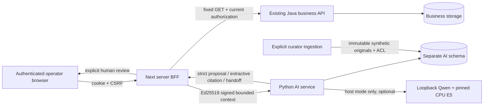

# Technical handoff and reviewer path

## Architecture and trust flow

The browser never chooses Java URLs, internal roles or supplier authority. Python
receives neither Java cookies/CSRF/trust secrets nor the private signing key.
Signed contexts bind body hash, action, actor, scope, run/step, nonce and expiry.
Sources are rechecked for current grant/version before release. AI tools cannot
confirm imports, activate profiles, restart jobs, checkout or mutate inventory.
The same request ID correlates bounded metadata across hops; source text and keys
are excluded from default logs.

## Interfaces and dependencies

The authoritative definitions are [gateway protocol](../contracts/gateway-protocol.md),
the JSON schemas in `src/vmarket_ai/gateway/wire.json`,
[architecture](../architecture.md) and [operations](../operations.md). Do not
replace them with this overview. Host semantic mode uses Python3.12, Node24,
Java21, PostgreSQL17/pgvector, existing Redis, pinned local E5 and Ollama Qwen4B.
Locks/pinned model digests in phase evidence determine exact versions.

The Docker AI mode is fake/read-only, requires explicit signed-container opt-in
and trusted public keys, uses a dedicated bridge and host-loopback publication.
Java/Next remain host processes in that demonstrated mode. It is not an all-app
Docker/Kubernetes/cloud deployment or an egress-firewalled network. External
provider requests are disabled; the pre-existing uncertain live ledger is retained.

## Fresh reviewer path

1. Clone AI_Applied and check out the referenced delivery commit. Keep `.env`
   private; no provider key is needed. Install Python3.12 and pinned uv0.13.6.
2. `python -m uv sync --locked`; `python -m uv run --frozen vmarket-ai migrate`;
   `python -m uv run --frozen vmarket-ai fake-check`. Start/stop only the local
   process you own. No real model-quality claim comes from fake-check.
3. Run `make lint typecheck test contracts dataset-check p13-check` (or the
   equivalent commands in Makefile). PG cases require the documented disposable
   DB opt-in. Clean final verification ran all PG cases with zero skips.
4. Inspect [P13](../evidence/P13.md), failure rows and limits before any demo;
   run `tools/ops_report.py` for metadata-only summaries. Verification is offline.
5. For integrated review, prepare Project2 at the pinned baseline and apply the
   local integration patches in order: P09, P10a, P10b, P11, P12, then P14-final.
   P14-final is cumulative from P12: do not apply both intermediate P14 and final
   P14 patches. Each patch's phase evidence pins its base/target. None was pushed
   to the Project2 remote. Verify hashes/tree and run Project2 tests/builds.
6. Build Docker AI and run `tools/p15_integrated.py --project2 <prepared-path>
   --output <fresh-path>` for disposable fake Docker integration/outage/restart.
   For actual local QA/browser, use the P14 acceptance command with the existing
   pinned bundle and Ollama. No implicit model download or cloud fallback.
7. Follow [demo scripts](demo-scripts.md), then inspect [honesty](honesty-report.md).
   Never infer customer acceptance or deployment from passing local tests.

## Ownership, change and support

The coding agent authored the AI integration, tests/eval/operational tools and
delivery documents under repository-owner direction. The pre-existing Project2
business platform is baseline work, not newly authored wholesale by this exercise.
The owner remains responsible for review, merge, real data, user permissions and
business approvals. Keep commits/patches and model/data hashes with handoff.

Changes to headers, policy, embeddings or models require a new version and dev
validation before fresh held-out evaluation. Do not tune on consumed test labels
and advertise the rerun as unseen. Back up AI storage/originals before migrations;
rollback disables AI flags first. Escalate safe correlation ID, versions, expected
versus actual result and bounded reproduction to the repository owner; omit keys,
cookies, private documents and unsanitized logs. No external support messages
have been sent and no commercial support SLA is promised.
