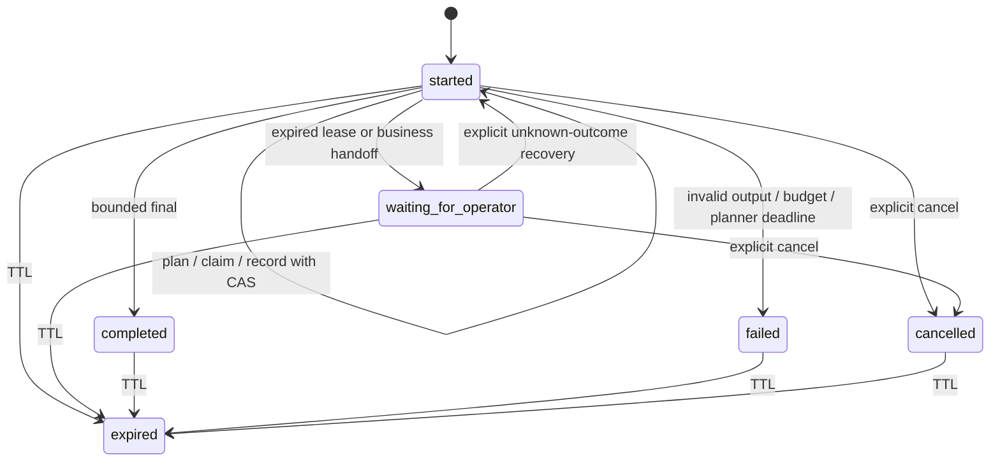

# Durable read-only runs (P11)

Both Python and Project2 use `AI_RUNS_ENABLED=false` by default. Enabling it
requires integrated mode, agent enabled, dedicated AI PostgreSQL, loopback and
valid BFF/public signing configuration. Python exposes only signed
`POST /ai/runs/control`; the browser uses `POST /api/ops/ai/runs` on its own BFF.
No unsigned standalone run endpoint is installed. P09's short live request and
P10's human business workflow remain available with their existing flags.

Browser commands are closed:

| Command | Input | Behavior |
| --- | --- | --- |
| start | question, optional allowed collection IDs | BFF mints conversation/run IDs and persists started revision0; no model or tool yet |
| inspect | run_id | Current owner/session/scope read; may mark an expired lease unknown or erase TTL-expired content |
| resume | run_id, expected_revision | Fresh auth; continues the bounded controller, or acknowledges uncertain read outcome without redispatch |
| cancel | run_id, expected_revision | Fences this run's future checkpoints and continuation |

No browser-supplied actor, tool result, lease, approval, URL, conversation ID or
private command is accepted. Stale revisions409 require inspection; absent and
other-owner runs both404. Expired/revoked/role-denied sessions401/403 do not reach
checkpoint/tool processing. All commands require current CSRF. Public JSON is
`{run: RunState, observations: Observation[]}` with correlation header. Run-state
observations remain historical status/count summaries. P12 adds transient projected
results only for reads executed by the current resume request; inspect/start/cancel
return an empty observations array. No cached body is replayed. A completed run
means the read controller ended, not a business write. See [P12 UI](operator-copilot.md).



Business handoff has terminal phase and `can_resume=false`. Unknown-read recovery
preserves its original call ID as unavailable, then ends with an abstention.
Active planning/execution leases cannot be stolen by another resume. A request
has25seconds including auth; each model/tool lease is bounded by that request and
run expiry. Limits: three tool attempts per run and at most four plans in an
uninterrupted request; explicit planning recovery also consumes the fixed
24-revision lifetime budget. Each run gets its own conversation correlation ID;
multi-run conversation memory is not implemented. Additional limits: 64KiB
request, 16KiB private snapshot/result, eight active runs per actor. BFF command
rate limiting is process-local20/minute, bounded1024 actors; it is not a
distributed rate limiter. CAS/slot guards are database-backed across processes.

Migration `0006_durable_runs` creates AI-only run/event tables and column grants.
Run `vmarket-ai migrate` with the separate migration credential. For retention,
run `vmarket-ai runs-maintain` with explicit `AI_MIGRATION_DATABASE_URL`; the app
role deliberately cannot delete run records. The command prints only expired/
purged counts. Maintenance must be invoked operationally; no scheduler was
provisioned by this phase. [Decision and retention details](adr/0007-durable-read-controller.md).

Reproduce opt-in process drills after building Project2's Next output and Java
JAR:

```powershell
uv run python tools/p11_local_smoke.py --project2 D:/CV/Project2 --output .local/new-p11-proof.json
```

The runner reserves loopback ports18094/18095/13014/8094, creates separate owned
Java PG/Redis and AI pgvector containers, and uses ephemeral signing/account
credentials. Its test-only network proxy holds a real authorized GET response.
It exercises a real25-second timeout, kills/restarts BFF/Python mid-read, tests
unknown recovery with no repeated GET, current-session expiry/role denial, stale
approval/resume, quota429, PG claim concurrency and owner-only retention. It uses
fake planning and synthetic data, not paid inference or model quality evaluation.
Owned service trees/containers are cleaned; never use its fault SQL against user
business storage. [Recorded execution](evidence/P11.md).
